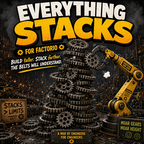

  

# WePlay: Everything Stacks

Every inserter and every loader in Factorio can stack items on belts. No stack inserters needed, and the base game doesn't need Space Age enabled.

**[Download on the Factorio Mod Portal](https://mods.factorio.com/mod/WePlayEverythingStacks)**

## Features

- **All inserters stack.** Burner, basic, long-handed, fast, bulk, and inserters from other mods all place stacked items on belts.
- **Hand size sets the stack.** The belt stack size is the smaller of the inserter's hand size and your researched belt stack size. A hand size of 2 makes stacks of 2, and a bulk inserter fills stacks up to your researched limit. Inserters with large hands grab an even multiple of the belt stack, so they always drop full stacks.
- **All loaders stack.** Vanilla and modded loaders, including AAI Loaders, stack items up to your researched belt stack size.
- **Belt stack size selector on loaders.** Each loader's GUI lets you choose its stack size.
- **Space Age not required.** With only the base game enabled, the mod adds its own belt stacking research.
- **Great for overhaul mods** like Krastorio 2 and Space Exploration.

## Research

Without Space Age, the mod adds three techs that match Space Age's tiers:

| Tech | Belt stack size | Bonus | Science |
|---|---|---|---|
| Belt stacking 1 | 2 | | Red, green, blue |
| Belt stacking 2 | 3 | | Adds purple |
| Belt stacking 3 | 4 | +1 non-bulk inserter capacity | Adds yellow |

With Space Age enabled, the mod adds no techs and uses Space Age's own Stack inserter and Transport belt capacity research.

## Requirements

- Factorio 2.1
- **You must own the Space Age expansion.** Factorio locks belt stacking behind the expansion feature flag. The Space Age mod itself can stay disabled.

## Startup settings

| Setting | Default | What it does |
|---|---|---|
| Max belt stack per inserter/loader | 4 | Hard cap per entity. Raise it only if another mod adds stacking beyond 4. |
| Loaders stack items | On | Turns loader stacking on or off. |

## Compatibility

- Inserters and loaders from other mods are patched automatically in `data-final-fixes`.
- Works alongside Space Age, Stack Inserters, AAI Loaders, Krastorio 2, and Space Exploration.

## Installation

Search for **WePlay: Everything Stacks** in the in-game mod manager, or download it from the [mod portal](https://mods.factorio.com/mod/WePlayEverythingStacks).

To run from source, clone this repo into your Factorio `mods` folder. The repo root is the mod folder.

## Feedback

Bug reports and ideas are welcome in the [mod portal Discussion tab](https://mods.factorio.com/mod/WePlayEverythingStacks/discussion) or as a GitHub issue.

## License

Released under [the Unlicense](LICENSE) (public domain). Do whatever you like with the code.
